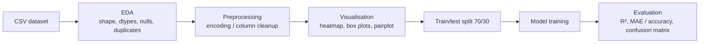

# Bharat Intern — Machine Learning Internship


Tasks completed during the **Machine Learning internship at Bharat Intern**: regression and classification models built in Jupyter notebooks.

---

## Tasks at a Glance

| # | Task | Type | Notebook | Status |
|---|---|---|---|---|
| 1 | House Price Prediction | Regression | `House_Price_Prediction.ipynb` | ✅ Complete |
| 2 | Wine Quality Prediction | Regression | `Wine Quality Prediction.ipynb` | 🚧 Notebook not yet filled in |
| 3 | Iris Flower Classification | Multiclass classification | `Iris Flower Dataset Classification.ipynb` | ✅ Complete |

## Workflow



---

## Task 1 — House Price Prediction

*A machine learning model that predicts house prices with linear regression.*

- **Dataset:** `Housing.csv`, 545 rows × 13 columns: `price`, `area`, `bedrooms`, `bathrooms`, `stories`, `mainroad`, `guestroom`, `basement`, `hotwaterheating`, `airconditioning`, `parking`, `prefarea`, `furnishingstatus` ([source link](https://drive.google.com/file/d/1LHaqSqbMvTMHDAx_rlhoqs52m1M09x5c/view?usp=drive_links))
- **Approach:** null and duplicate checks (none found), label-encode the seven categorical columns, correlation heatmap, 70/30 split (381 train / 164 test), `LinearRegression`
- **Results (notebook output):**

| Metric | Value |
|---|---|
| R² | 0.644 |
| MAE | 925,543.55 |

## Task 2 — Wine Quality Prediction

*A machine learning model that predicts wine quality with linear regression.*

- **Dataset:** `winequality.csv`, 1,599 rows with 11 physicochemical features (`fixed acidity`, `volatile acidity`, `citric acid`, `residual sugar`, `chlorides`, `free sulfur dioxide`, `total sulfur dioxide`, `density`, `pH`, `sulphates`, `alcohol`) and the target `quality` ([source link](https://drive.google.com/file/d/1CfwNyFVI7yfT_jL9sRiqSmCuqLjnlBSE/view?usp=drive_link))
- **Status:** the dataset is committed, but the notebook is still an empty placeholder.

## Task 3 — Iris Flower Classification

*Predicts the species of an iris flower from the length and width of its petals and sepals.*

- **Dataset:** `iris-flowers.csv`, 150 rows, 4 features (`Sepal.Length`, `Sepal.Width`, `Petal.Length`, `Petal.Width`), 3 balanced classes (setosa, versicolor, virginica; 50 each) ([source link](https://drive.google.com/file/d/1Ioe3_LFo-2BoCBkycM1xZzply1Sepdch/view?usp=drive_link))
- **Approach:** drop the index column, check for outliers with box plots, histograms, pairplot by species, 70/30 split (105 train / 45 test), four classifiers compared
- **Results (notebook output, test accuracy):**

| Model | Accuracy |
|---|---|
| Logistic Regression | 97.78% |
| Support Vector Machine (SVC) | 97.78% |
| K-Nearest Neighbors (k=5) | 95.56% |
| Gaussian Naive Bayes | 95.56% |

---

## Tech Stack

- **Language:** Python
- **Libraries:** pandas, NumPy, scikit-learn, Matplotlib, Seaborn
- **Environment:** Jupyter Notebook

## Project Structure

```
Bharat-Intern/
├── House_Price_Prediction.ipynb
├── Housing.csv
├── Iris Flower Dataset Classification.ipynb
├── iris-flowers.csv
├── Wine Quality Prediction.ipynb
├── winequality.csv
├── .gitignore
└── README.md
```

## How to Run

```bash
git clone https://github.com/Gonugunta-Venkata-Jayanth/Bharat-Intern.git
cd Bharat-Intern
pip install pandas numpy scikit-learn matplotlib seaborn jupyter
jupyter notebook
```

> The notebooks read the CSVs from absolute Windows paths. Change the `pd.read_csv(...)` path to the local file before running, e.g. `pd.read_csv("Housing.csv")` or `pd.read_csv("iris-flowers.csv")`.

## Author

**Jayanth Gonugunta Venkata** · [GitHub](https://github.com/Gonugunta-Venkata-Jayanth)
